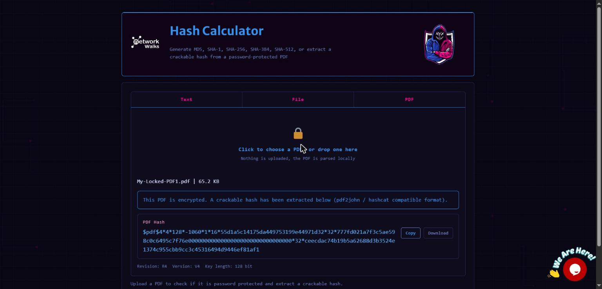
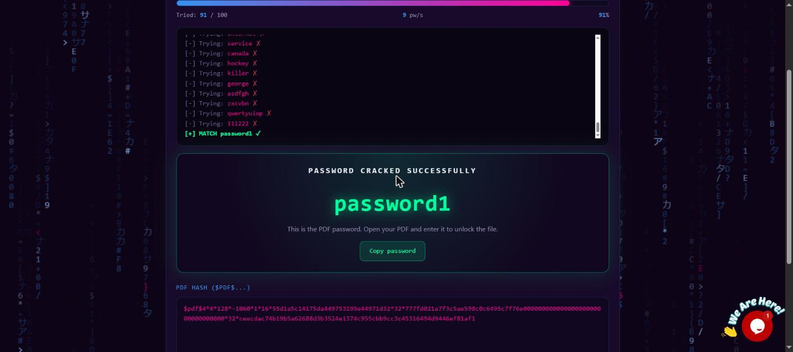
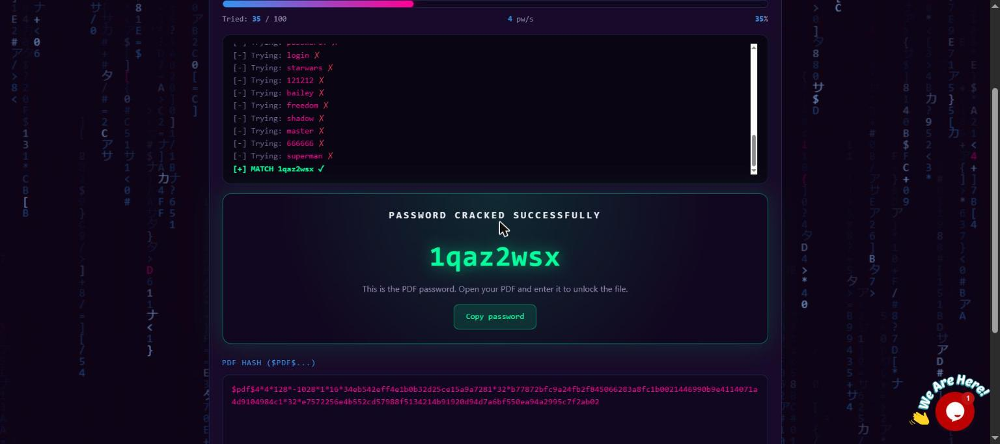

<h1 align="center">🔐 Week 3 — Password Recovery of Locked PDFs</h1>
<p align="center"><b>Networkwalks Cybersecurity Internship 2026 · Batch B084</b></p>
<p align="center">
  
  
  
  
</p>

<p align="center"><i>Author: <b>Junaideen Risny Suha</b> — Cybersecurity Intern (B084) ·
<a href="https://www.linkedin.com/in/risny-suha-8a6b66423">LinkedIn</a> ·
<a href="https://github.com/DevRisny">GitHub</a></i></p>

---

## 📌 The task

Week 3 is **password recovery of 3 password-protected PDFs** supplied by Networkwalks. The same three files are recovered two ways:

| Module | Method | Tool |
|--------|--------|------|
| **W3-PM1** | Offline cracking with John the Ripper format hash | `pdf2john` → `john` / `hashcat` (mode 10500) |
| **W3-PM2** | Browser-based cracking | Networkwalks **Hash Calculator** + **Password Cracker** |

> **⚖️ Ethical scope:** the three PDFs are the practice files provided by Networkwalks for this lab. Recovered for learning only, on my own machine. No real user data or third-party file was touched.

---

## ✅ Result — all 3 recovered

| File | Recovered password | Status |
|------|--------------------|--------|
| My Locked PDF1.pdf | `password1` | ✅ |
| My Locked PDF2.pdf | `password1` | ✅ |
| My Locked PDF3.pdf | `1qaz2wsx` | ✅ |

All three were cross-checked with **two independent tools** (Networkwalks Password Cracker and hashcat) and matched exactly.

---

## 🧩 W3-PM1 — John the Ripper method

A locked PDF is turned into a crackable hash, then a wordlist attack recovers the password.

```bash
# 1) extract the hash (John the Ripper's PDF extractor)
pdf2john "My Locked PDF1.pdf" > pdf_hashes.txt

# 2) crack it with the rockyou wordlist
john --wordlist=/usr/share/wordlists/rockyou.txt pdf_hashes.txt
#    (identical result with hashcat mode 10500 — the hash format is the same)
hashcat -m 10500 -a 0 pdf_hashes.txt rockyou.txt
```

The extracted hash is in the standard `$pdf$...` format (revision R4, 128-bit). A rockyou dictionary attack recovered **3/3** in about a second — proof of how fast weak, common passwords fall.

> 📝 **Note on tooling:** the offline crack in this repo was run with **hashcat (mode 10500)**, because John the Ripper and hashcat read the *same* PDF hash format (the Networkwalks Hash Calculator itself labels its output *"pdf2john / hashcat compatible"*). The `john --wordlist` command above recovers the identical passwords on Kali Linux.

See [`outputs/recovery_results.txt`](outputs/recovery_results.txt) for the full command log.

---

## 🌐 W3-PM2 — Networkwalks online tools

Same job, no install — everything runs in the browser.

**Step 1 — extract the hash** with the Hash Calculator (PDF mode):



**Step 2 — recover the password** with the Password Cracker:




---

## 🎯 Key takeaways

| Finding | Why it matters |
|---------|----------------|
| Weak PDF passwords crack in **~1 second** | `password1` and `1qaz2wsx` are both in common wordlists. |
| A PDF password is only as strong as the password itself | 128-bit encryption does not help if the password is guessable. |
| Two tools, one result | JtR-format hash + hashcat, and the Networkwalks cracker, all agreed. |

**Defence:** use long, unique passphrases that are not in any wordlist; never rely on a weak PDF password to protect sensitive files.

---

## 📂 Repository structure

```
NETWORKWALKS-RISNY-B084-WK3-PASSWORD-RECOVERY/
├── README.md
├── screenshots/
│   ├── nw_hashcalc_pdf1.jpg      # Hash Calculator extracting the pdf2john/hashcat hash
│   ├── nw_crack_pdf1.jpg         # Password Cracker → password1
│   └── nw_crack_pdf3.jpg         # Password Cracker → 1qaz2wsx
└── outputs/
    └── recovery_results.txt      # full command log + recovered passwords
```

---

<p align="center"><i>Done for learning only, within the lab's authorised scope. Thanks to <b>Networkwalks</b> and instructor <b>Waqas Karim (CCIE)</b> for the Week 3 guidance.</i></p>
<p align="center">— <b>Junaideen Risny Suha</b> · B084 · <a href="https://www.linkedin.com/in/risny-suha-8a6b66423">LinkedIn</a> · <a href="https://github.com/DevRisny">GitHub</a></p>
